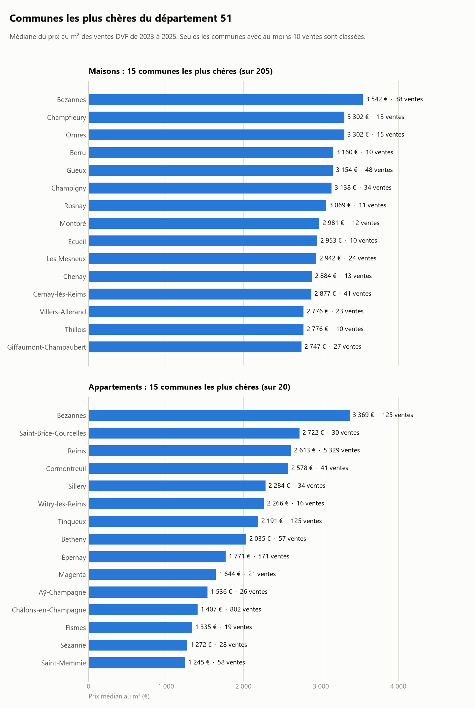

# estimateur-immo

Estime une fourchette de prix pour un bien (maison ou appartement) dans une commune, à partir des
ventes réellement enregistrées dans les **Demandes de valeurs foncières géolocalisées (DVF)**
publiées sur data.gouv.fr.

```powershell
python estimer.py --commune Reims --type Appartement --surface 65
```

```
Reims - Appartement, 65 m²
Fourchette estimée : 134 000 € à 207 000 €
Prix médian : 170 000 € (2 613 €/m²)
Basé sur 5329 ventes de 2023 à 2025.
```

État actuel, testé sur le département de la Marne (51), ventes de 2023 à 2025 :

| Fonctionnalité | Statut |
|---|---|
| Chargement des fichiers DVF d'un département, sur plusieurs années | fait |
| Nettoyage des ventes (maisons et appartements, prix au m²) | fait |
| Statistiques de prix par commune et par type de bien | fait |
| Outil en ligne de commande `estimer.py` | fait |
| Graphique des communes les plus chères | fait |
| API (FastAPI) réutilisant les mêmes fonctions | à venir |



## Le trajet des données

Tout part des fichiers bruts et se transforme en trois temps. Chaque flèche est une fonction
de `immo.py`.

```
 data/51 2023.csv
 data/51 2024.csv           tableau brut               ventes propres              statistiques
 data/51 2025.csv           86 538 lignes              17 562 lignes               656 lignes
      │                          │                          │                          │
      │   charger("51")          │   nettoyer(df)           │   prix_par_commune(df)   │
      └────────────────────────► └────────────────────────► └────────────────────────► └──► data/prix_communes.csv
                                                                                                    │
                                                         estimer(...)  et  classer_communes(...) ◄──┘
                                                         (estimation d'un bien)   (classement des communes)
```

Les fichiers d'origine ne sont **jamais modifiés**. Les fonctions travaillent sur des copies en
mémoire. Seuls `data/prix_communes.csv` et l'image du graphique sont écrits.

## Qui fait quoi, qui appelle qui

```
estimateur-immo/
├── data/                 fichiers de données, ignorés par Git
│   ├── 51 2023.csv       entrées : un fichier DVF par département et par année
│   ├── 51 2024.csv       (téléchargés à la main, nommés « <département> <année>.csv »)
│   ├── 51 2025.csv
│   └── prix_communes.csv sortie : les statistiques par commune (créé par explorer.py)
├── docs/
│   └── communes_les_plus_cheres.png   le graphique (créé par graphique.py)
│
├── immo.py               LA LOGIQUE : toutes les fonctions
├── explorer.py           script : explore les données et produit prix_communes.csv
├── estimer.py            script : l'outil en ligne de commande
├── graphique.py          script : trace le graphique
├── api.py                l'API HTTP (FastAPI) : appelle immo.py pour le site
├── Dockerfile            l'image Docker de l'API (code seul, sans les données)
├── .dockerignore         liste blanche des fichiers envoyés à Docker
├── docker-compose.yml    lance l'API et Caddy (HTTPS) ensemble
├── Caddyfile             configuration de Caddy : domaine et redirection vers l'API
├── requirements.txt      toutes les bibliothèques du projet (développement)
├── requirements-api.txt  seulement celles dont l'API a besoin (utilisé par le Dockerfile)
└── README.md
```

```
 explorer.py ───┐                        ┌──► data/<département> <année>.csv   (lecture)
 estimer.py  ───┤                        │
 graphique.py ──┼── importent immo.py ───┤
 api.py ────────┘                        └──► data/prix_communes.csv           (lecture)

 écritures : explorer.py  → data/prix_communes.csv
             graphique.py → docs/communes_les_plus_cheres.png
```

- **`immo.py` fait le travail.** Il contient les fonctions, et seulement elles. Il ne lit pas
  d'arguments de terminal et ne fait ni `print`, ni `input`, ni `sys.exit` : il reçoit des
  paramètres et renvoie des valeurs ou lève des exceptions. Le département, les années, le dossier
  des données et les seuils sont des paramètres, jamais écrits en dur dans les calculs.
- **Les scripts et l'API sont des « façades ».** Chacun lit ses entrées (arguments du terminal,
  requête HTTP, constantes), appelle les fonctions de `immo.py` et présente le résultat. Ils n'ont
  aucune logique de calcul propre.
- **Pourquoi cette séparation :** la logique est écrite une seule fois. L'API l'appelle comme le
  fait le terminal. Les erreurs de `estimer()` sont des `ValueError` : le terminal les affiche,
  l'API les transforme en réponse HTTP 404 ou 422.

### Ordre d'utilisation

1. `python explorer.py` lit les fichiers DVF, nettoie, agrège et écrit `data/prix_communes.csv`.
   Il affiche aussi des diagnostics sur les données (taille, types de biens, cases vides) et ce
   que retire chaque étape du nettoyage.
2. `python estimer.py ...` et `python graphique.py` lisent ensuite `data/prix_communes.csv`.

## Les fonctions de `immo.py`

### `charger(departement, annees=(2023, 2024, 2025), dossier=data/)`

Lit les fichiers `<dossier>/<departement> <annee>.csv` et les empile en un seul tableau brut,
sans rien filtrer. Une colonne `annee` indique de quel fichier vient chaque ligne. Les codes de
département, de commune et postal sont lus comme du **texte** : sinon `01` deviendrait `1`, et
`2A`/`2B` (Corse) poseraient problème. Les `id_mutation` commencent par l'année
(`2025-653539`) : deux fichiers ne peuvent pas avoir le même identifiant de vente.

### `nettoyer(df, prix_m2_min=300, prix_m2_max=10000)`

Garde uniquement les ventes exploitables pour estimer un prix au m² et ajoute la colonne
`prix_m2`. Ce que retire chaque étape est noté dans le journal du module (`logging`, niveau
INFO) : rien ne s'affiche tant que le programme appelant n'active pas les messages, comme le fait
`explorer.py`. Résultat sur le département 51, années 2023 à 2025 :

| # | Filtre | Pourquoi | Lignes retirées | Restantes |
|---|---|---|---:|---:|
| | Fichiers bruts | | | 86 538 |
| 1 | `type_local` = Maison ou Appartement | Les terrains, dépendances et locaux professionnels n'ont pas de surface de logement | 62 814 | 23 724 |
| 2 | `nature_mutation` = Vente | Échanges, adjudications et ventes sur plan n'ont pas un prix comparable | 672 | 23 052 |
| 3 | Prix > 0 et surface > 0 | Un prix ou une surface vide ou nul ne permet pas de calcul | 34 | 23 018 |
| 4 | Une seule ligne par vente | Voir ci-dessous | 5 245 | 17 773 |
| 5 | Prix au m² entre 300 et 10 000 € | Écarte les ventes symboliques (1 €) et les erreurs de saisie (180 000 €/m²) | 211 | 17 562 |

**Pourquoi « une seule ligne par vente » ?** Dans le fichier DVF, une vente (`id_mutation`)
occupe une ligne par parcelle ou par lot, et la colonne `valeur_fonciere` y répète le prix
**total**. Pour une vente de deux logements, on ne peut pas savoir quelle part du prix revient à
chacun. On ne garde donc que les ventes qui n'ont qu'un seul logement.

Le comptage se fait **après** le filtre sur les maisons et appartements : une maison vendue
avec un garage ou un terrain reste une vente à un seul logement.

**Limite connue :** parmi les ventes à plusieurs lignes (1 868 sur ces trois années), environ la
moitié (914) ne contiennent en réalité qu'un seul logement, répété sur plusieurs parcelles. Elles
sont écartées avec les autres. C'est prudent, et il reste assez de données, mais ce n'est pas
parfait.

### `prix_par_commune(df)`

Reçoit les ventes propres et renvoie une ligne par **commune et par type de bien** (une
médiane mêlant maisons et appartements n'aurait pas de sens). Colonnes :

| Colonne | Contenu |
|---|---|
| `code_commune` | Code INSEE, identifiant unique de la commune |
| `nom_commune` | Nom, pour l'affichage |
| `type_local` | `Maison` ou `Appartement` |
| `mediane` | Médiane du prix au m² |
| `quartile_1`, `quartile_3` | 1er et 3e quartile : 25 % des ventes sont en dessous du premier, 25 % au-dessus du second |
| `nombre_ventes` | Nombre de ventes sur lesquelles reposent ces chiffres |
| `annee_min`, `annee_max` | Première et dernière année des ventes prises en compte |

Sur le département 51 : 656 lignes (586 maisons, 70 appartements).

### `charger_prix_communes(dossier=data/)`

Relit `prix_communes.csv`. Si le fichier n'existe pas, lève une `FileNotFoundError` qui indique
comment le générer.

### `estimer(prix, commune, type_local, surface, ventes_min=10)`

Cherche la commune et le type de bien dans le tableau des statistiques et renvoie un
dictionnaire : `prix_bas` (surface × 1er quartile), `prix_median`, `prix_haut` (surface × 3e
quartile), `prix_m2_median`, `nombre_ventes`, `annee_min`, `annee_max`, `commune`, `type_local`,
`surface`.

Le nom de la commune est comparé sans tenir compte de la casse, des accents ni des tirets :
`epernay`, `ÉPERNAY` et `Épernay` désignent la même commune, comme `chalons en champagne` et
`Châlons-en-Champagne`.

Erreurs, toutes levées en `ValueError` avec un message lisible. Deux sous-classes les distinguent :
`ParametreInvalide` (la requête est incorrecte) et `BienIntrouvable` (la requête est correcte,
mais les données ne permettent pas de répondre). L'API en tire le code HTTP.

| Cas | Exception | Message (extrait) | Code HTTP |
|---|---|---|---|
| Surface hors de 0 à 10 000 m² (ou `nan`, `inf`) | `ParametreInvalide` | La surface doit être comprise entre 0 et 10000 m² | 422 |
| Type de bien autre que Maison ou Appartement | `ParametreInvalide` | Type de bien inconnu | 422 |
| Plusieurs communes de même nom | `ParametreInvalide` | Plusieurs communes s'appellent ... (codes ...) | 422 |
| Nom de commune absent du tableau | `BienIntrouvable` | Commune introuvable | 404 |
| Commune sans vente de ce type de bien | `BienIntrouvable` | Aucune vente exploitable de maison à ... | 404 |
| Moins de 10 ventes | `BienIntrouvable` | Seulement N vente(s) ... : il en faut au moins 10 | 404 |

### `noms_communes(prix)` et `zone_couverte(prix)`

`noms_communes` renvoie les noms des communes du tableau, sans doublon, triés sans tenir compte
des accents. `zone_couverte` décrit ce que couvrent les données : les départements (déduits des
codes de commune), la première et la dernière année, le nombre de communes. Rien n'est écrit en
dur : changer de département ou d'années change la réponse. Les deux servent à l'API
(`/communes` et `/info`).

### `classer_communes(prix, type_local, ventes_min=10)`

Classe les communes d'un type de bien de la plus chère à la moins chère (médiane du prix au
m²), en ne gardant que celles qui comptent assez de ventes. Utilisée par `graphique.py`.

## Les scripts

### `estimer.py`

```powershell
python estimer.py --commune Épernay --type Maison --surface 110
python estimer.py -h
```

Les trois arguments sont obligatoires. En cas d'erreur, le message est affiché sur la sortie
d'erreur et le code de retour vaut 1, sans trace d'erreur Python.

### `graphique.py`

Trace deux classements en barres horizontales, un pour les maisons et un pour les appartements
(les 15 communes les plus chères de chaque type), avec la médiane du prix au m² et le nombre de
ventes. Seules les communes d'au moins 10 ventes sont classées. L'image est écrite dans `docs/`.

## L'API

`api.py` expose les fonctions de `immo.py` en HTTP, pour le site. Elle ne contient aucune logique
métier : elle traduit les requêtes en appels à `immo.py` et les résultats en réponses JSON.
`data/prix_communes.csv` est lu **une seule fois**, au démarrage ; si le fichier manque, le
serveur refuse de démarrer avec un message clair.

```powershell
python -m uvicorn api:app --reload      # http://127.0.0.1:8000, documentation sur /docs
```

| Route | Réponse |
|---|---|
| `GET /health` | `{"status": "ok"}` : vérifie que le service tourne |
| `GET /communes` | la liste des noms de communes connues (autocomplétion) |
| `GET /info` | la zone couverte, déduite des données : `{"departements": ["51"], "annee_min": 2023, "annee_max": 2025, "nombre_communes": 586}` |
| `GET /estimation?commune=Reims&type_local=Appartement&surface=65` | le dictionnaire de `estimer()` |

Erreurs de `/estimation`, au format `{"detail": "message"}` : **404** si le bien est introuvable
(commune inconnue, aucune vente de ce type, moins de 10 ventes), **422** si un paramètre est
invalide (surface, type de bien, commune ambiguë). Un paramètre manquant ou non numérique donne
aussi un 422, dont le détail est une liste (format standard de FastAPI).

Le **CORS** limite les appels depuis un navigateur aux sites listés dans la variable
d'environnement `ORIGINES_AUTORISEES` (séparés par des virgules). Par défaut :
`https://www.tatane.me`, `https://tatane.me` et `http://localhost:4321`. Ce n'est **pas** une
protection d'accès : `curl` ou un script ignorent le CORS, qui n'empêche que l'usage de l'API par
un autre site, depuis le navigateur de ses visiteurs.

### Limite de requêtes

Pour éviter qu'un visiteur ne sature le serveur, chaque adresse IP est limitée (bibliothèque
`slowapi`) : **30 requêtes par minute** sur `/estimation`, **60 par minute** sur `/communes` et
`/info` (un compteur par route et par visiteur). `/health` n'est pas limitée : le contrôle de
santé de Docker l'appelle toutes les 30 secondes. Au-delà, l'API répond **429** avec
`{"detail": "Trop de requêtes : réessayez dans une minute."}` et l'en-tête `Retry-After`. La
réponse 429 porte aussi les en-têtes CORS, pour que le site puisse l'afficher, et déclare
`Retry-After` dans `Access-Control-Expose-Headers` : sans cela, le navigateur cache cet en-tête au
JavaScript du site.

- Les seuils se règlent avec les variables d'environnement `LIMITE_ESTIMATION` et `LIMITE_DEFAUT`
  (par exemple `30/minute`).
- Les compteurs sont gardés en mémoire : ils repartent de zéro quand l'API redémarre.
- Derrière Caddy, l'adresse du visiteur est lue dans l'en-tête `X-Forwarded-For` (options
  `--proxy-headers` et `--forwarded-allow-ips` du `Dockerfile`). Sans cela, tous les visiteurs
  partageraient l'adresse de Caddy, donc une seule limite. Falsifier cet en-tête ne contourne rien :
  Caddy le remplace par l'adresse réelle du client, et l'API n'est joignable que par Caddy.

### Dans Docker

L'image contient le code (`api.py`, `immo.py`) et les bibliothèques de `requirements-api.txt`
(pandas, FastAPI, uvicorn : environ 280 Mo, sans matplotlib ni scikit-learn). Elle ne contient
**pas** les données : `data/prix_communes.csv` est monté au lancement, depuis le dossier du serveur
où il a été déposé. Le serveur tourne avec un utilisateur sans droits (`appuser`), et un
`HEALTHCHECK` interroge `/health`.

```powershell
docker build -t estimateur-immo-api .
docker run -d --name estimateur-api -p 127.0.0.1:8000:8000 -v "${PWD}/data:/app/data:ro" estimateur-immo-api
```

- `-v ...:/app/data:ro` monte le dossier des données en **lecture seule**. Sans lui, le conteneur
  refuse de démarrer et le dit.
- `-p 127.0.0.1:8000:8000` ne rend l'API accessible que depuis la machine elle-même. Sur un
  serveur, c'est le reverse proxy (Caddy) qui la publie en HTTPS : le port 8000 n'est jamais
  ouvert sur Internet.
- **En production**, `docker compose up -d --build` lance l'API et Caddy ensemble. Caddy est le
  seul conteneur qui publie des ports (80 et 443) : il obtient et renouvelle le certificat HTTPS
  de `api.tatane.me` et transmet les requêtes à l'API, qui n'est publiée nulle part. Les données
  sont lues dans `./data`, à côté de `docker-compose.yml`.
- `requirements-api.txt` est une liste minimale, épinglée. Après un changement de version dans
  `requirements.txt`, la régénérer dans un environnement vierge qui ne contient que
  `fastapi`, `uvicorn`, `slowapi`, `pandas` et `numpy`.

## Choix de méthode

- **Médiane plutôt que moyenne.** Une seule vente aberrante (un bien d'exception, une erreur
  de saisie) déplace beaucoup la moyenne et très peu la médiane.
- **Une fourchette plutôt qu'un prix unique.** Les deux quartiles encadrent la moitié centrale
  des ventes.
- **Le nombre de ventes compte.** Beaucoup de communes n'ont que quelques ventes : leur
  médiane n'est pas fiable. L'outil refuse de donner une fourchette sous 10 ventes.
- **Trois années par défaut (2023 à 2025).** Plus d'années donnent plus de ventes par commune,
  mais mélangent des niveaux de prix différents. Dans la Marne, le prix médian au m² est resté
  stable de 2022 à 2025 (maisons autour de 1 920 €, appartements entre 2 270 € et 2 350 €), alors
  que 2021 est nettement plus bas (1 854 € et 2 146 €). Le nombre de couples commune/type de bien
  qui atteignent 10 ventes dépend directement des années retenues :

  | Années retenues | Couples avec au moins 10 ventes |
  |---|---:|
  | 2025 seule | 77 |
  | 2024 à 2025 | 154 |
  | **2023 à 2025 (défaut)** | **225** (205 maisons, 20 appartements) |
  | 2022 à 2025 | 300 |
  | 2021 à 2025 | 355 |

  Le choix se règle avec le paramètre `annees` de `charger()` ou la constante `ANNEES`.

## Limites

L'estimation est une **statistique descriptive** : la médiane et les quartiles des ventes passées
d'une commune, multipliés par la surface. Ce n'est pas un modèle prédictif. Elle ne tient pas compte
du nombre de pièces, de l'étage, de l'état du bien, du terrain, du quartier ni de l'évolution
des prix à l'intérieur de la période. Elle donne un ordre de grandeur, pas une évaluation.

## Les données

- Source : DVF géolocalisées, sur data.gouv.fr (un fichier CSV par département et par année).
- Période des fichiers utilisés : du 2 janvier 2023 au 31 décembre 2025.
- Nommage attendu : `data/<département> <année>.csv`, par exemple `data/51 2025.csv`.
- Une ligne du fichier n'est **pas** une vente : c'est une parcelle ou un lot d'une vente.
  Une même vente peut donc occuper plusieurs lignes qui partagent le même `id_mutation`.
- Colonnes utilisées : `id_mutation`, `nature_mutation`, `valeur_fonciere`, `code_commune`,
  `nom_commune`, `type_local`, `surface_reelle_bati`.
- Le dossier `data/` n'est pas versionné : les données sont volumineuses et se re-téléchargent.

## Installation et utilisation

Prérequis : Python 3.12 ou plus. Commandes pour PowerShell, depuis la racine du projet :

```powershell
python -m venv .venv
.\.venv\Scripts\Activate.ps1
python -m pip install -r requirements.txt
```

Placer ensuite les fichiers DVF du département dans `data/`, avec le nommage ci-dessus (par
exemple `data/51 2023.csv`, `data/51 2024.csv` et `data/51 2025.csv`), puis :

```powershell
python explorer.py                 # produit data/prix_communes.csv
python estimer.py --commune Reims --type Appartement --surface 65
python graphique.py                # produit docs/communes_les_plus_cheres.png
python -m uvicorn api:app          # lance l'API sur http://127.0.0.1:8000
```

Depuis du code Python, les fonctions s'utilisent directement :

```python
import logging
from immo import charger, nettoyer, prix_par_commune, estimer

logging.basicConfig(level=logging.INFO, format="%(message)s")  # facultatif : affiche ce que retire nettoyer()

propre = nettoyer(charger("51"))
stats = prix_par_commune(propre)
print(estimer(stats, "Reims", "Appartement", 65))
```

## Suite prévue

La mise en ligne de l'API (conteneur Docker, serveur, HTTPS), puis la prise en charge de plusieurs
départements.
