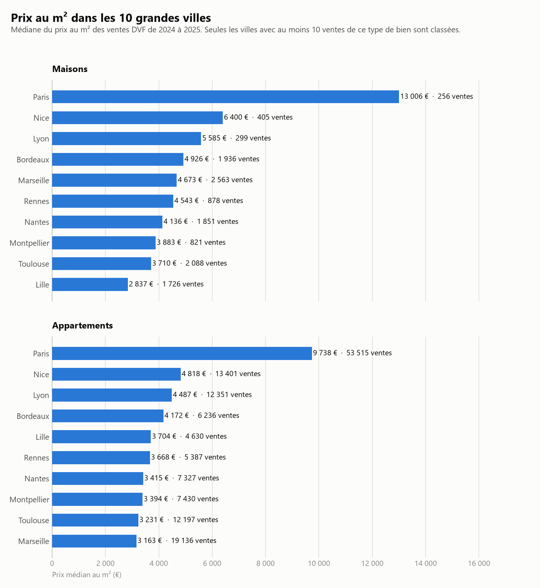

# estimateur-immo

[](https://github.com/EtanDct/estimateur-immo/actions/workflows/ci.yml)

Estime une fourchette de prix pour un bien (maison ou appartement) dans l'une des dix plus grandes
villes de France, à partir des ventes réellement enregistrées dans les **Demandes de valeurs
foncières géolocalisées (DVF)** publiées sur data.gouv.fr. Les estimations viennent d'un modèle
de machine learning (scikit-learn) dont l'erreur est mesurée sur des ventes qu'il n'a jamais vues,
et comparée à une simple médiane par commune.

```powershell
python -m estimateur estimer --commune "Lyon 3e Arrondissement" --type Appartement --surface 65 --latitude 45.7578 --longitude 4.8520
```

```
Lyon 3e Arrondissement - Appartement, 65 m²
Fourchette estimée : 258 000 € à 319 000 €
Prix médian : 291 000 € (4 478 €/m²)
Méthode : modèle tenant compte de l'adresse. Statistiques de la commune : 2519 ventes de 2024 à 2025.
```

Une API HTTP (FastAPI) expose les mêmes fonctions : `https://api.tatane.me`.

## Ce que le modèle apporte

Entraînement sur les ventes de 2021 à 2024, test sur les **83 310 ventes de 2025** : le modèle ne
voit jamais le prix des ventes qu'il estime. L'erreur est celle du prix au m² ; la fourchette est
l'intervalle entre le 25e et le 75e centile, qui doit contenir 50 % des ventes réelles.

| Méthode | Erreur médiane | Erreur moyenne (€/m²) | Largeur de la fourchette | Part des ventes dans la fourchette |
|---|---:|---:|---:|---:|
| Médiane de la commune, toutes les années | 18,2 % | 1 359 | 36,5 % | 49,8 % |
| Médiane de la commune, dernière année (référence) | 17,4 % | 1 313 | 37,5 % | 50,9 % |
| Modèle « commune » : commune, type, surface, année | 16,5 % | 1 261 | 34,3 % | 50,4 % |
| Modèle « commune » + pièces et terrain | 16,2 % | 1 245 | 33,2 % | 50,4 % |
| **Modèle « adresse » : type, surface, année, position** | **13,9 %** | **1 129** | **28,3 %** | **50,1 %** |
| Modèle complet (plafond) | 13,7 % | 1 118 | 27,7 % | 49,9 % |

Ce que ces mesures montrent :

- **La position du bien est ce qui compte.** Avec l'adresse, l'erreur médiane passe de 17,4 % à
  13,9 % par rapport à la meilleure référence, et la fourchette se resserre de 25 % à couverture
  égale. Le nombre de pièces et la surface du terrain n'apportent presque rien : le formulaire ne
  les demande donc pas.
- **Les prix récents comptent.** Une médiane sur la dernière année estime mieux 2025 qu'une médiane
  sur quatre ans, et l'année est une variable du modèle.
- **Le gain varie selon la ville.** Avec l'adresse, l'erreur médiane de Toulouse passe de 22,2 % à
  13,3 % et celle de Lille de 19,8 % à 14,1 % ; celle de Paris, déjà régulière, de 13,7 % à 12,3 %.
- **Les fourchettes sont calibrées** : dans chaque méthode, environ la moitié des ventes réelles
  tombent dans l'intervalle annoncé.



## Le trajet des données

```
 data/villes/75 2021.csv … 75 2025.csv     (un fichier DVF par département et par année,
 data/villes/13 2021.csv … 13 2025.csv      téléchargés par la commande construire : 10 départements)
              │
              │  construire   telecharger → charger → nettoyer → regrouper_communes → prix_par_commune
              ▼
 data/villes/ventes_propres.csv   (432 579 ventes, une ligne par vente)     data/villes/prix_communes.csv   (statistiques par commune)
              │                                                                          │
              │  evaluer    (mesure les modèles, écrit evaluation.json)                  │
              │  modeliser  (entraîne les modèles finaux)                                │
              ▼                                                                          │
 data/villes/modeles.joblib ───────────────────────────────────────────────┐            │
                                                                            ▼            ▼
                                                   estimer (terminal) · api (HTTP) · graphique
```

Les fichiers d'origine ne sont **jamais modifiés** : les fonctions travaillent sur des copies en
mémoire. `data/` est ignoré par Git.

## Qui fait quoi, qui appelle qui

```
estimateur-immo/
├── estimateur/              le paquet Python : tout le code
│   ├── config.py            chemins et constantes partagés (seuils, types de biens, dossiers)
│   ├── donnees.py           LES DONNÉES : télécharger, charger, nettoyer, agréger
│   ├── estimation.py        L'ESTIMATION PAR MÉDIANE : vérifier une demande, trouver la commune, erreurs
│   ├── modele.py            LE MODÈLE : séparation par année, référence, entraînement, mesures, estimation
│   ├── villes.py            la liste des dix villes, avec leurs codes de commune
│   ├── api.py               l'API HTTP (FastAPI) : appelle estimation.py et modele.py pour le site
│   ├── cli.py               le point d'entrée en ligne de commande : python -m estimateur <commande>
│   └── commandes/           une commande par module
│       ├── construire.py    télécharge et prépare les données
│       ├── evaluer.py       compare les modèles à la référence sur 2025
│       ├── modeliser.py     entraîne et enregistre les modèles finaux
│       ├── estimer.py       estime le prix d'un bien
│       ├── graphique.py     trace le graphique
│       └── explorer.py      explore les fichiers DVF d'un département (diagnostics)
├── tests/                   les tests pytest, sur des ventes factices (voir « Tests et intégration continue »)
├── .github/workflows/       l'intégration continue : style, tests, image Docker
├── data/                    données, ignorées par Git (sous-dossier villes/ : celles du projet)
├── docs/                    le graphique
│
├── pyproject.toml           métadonnées du projet et réglages de pytest et ruff, commande installable `estimateur`
├── requirements.txt         toutes les bibliothèques du projet (développement)
├── requirements-api.txt     seulement celles dont l'API a besoin (utilisé par le Dockerfile)
├── requirements-dev.txt     l'API, plus pytest et ruff (utilisé par la CI)
├── Dockerfile               l'image Docker de l'API (code seul, sans les données)
├── .dockerignore            liste blanche des fichiers envoyés à Docker
├── docker-compose.yml       lance l'API et Caddy (HTTPS) ensemble
├── Caddyfile                configuration de Caddy : domaine et redirection vers l'API
├── .env.example             modèle du fichier .env du serveur (clés d'API)
└── README.md
```

```
 commandes/*  (terminal)  ─┐
 api.py       (HTTP)      ─┴──► modele.py ──► estimation.py ──► config.py
                                    │                ▲
                                    └──► donnees.py ─┘   villes.py
```

- **`donnees.py`, `estimation.py` et `modele.py` font le travail.** Ils contiennent les fonctions, et
  seulement elles. Ils ne lisent pas d'arguments de terminal et ne font ni `print`, ni `input`, ni
  `sys.exit` : ils reçoivent des paramètres et renvoient des valeurs ou lèvent des exceptions. Les
  départements, les années, les dossiers et les seuils sont des paramètres.
- **Les commandes et l'API sont des « façades ».** Chacune lit ses entrées (arguments du terminal,
  requête HTTP), appelle ces fonctions et présente le résultat. Elles n'ont aucune logique de calcul
  propre. Une commande est un module qui définit `ajouter_arguments(parser)` et `executer(args)` ;
  `cli.py` ne l'importe que si on la lance.
- **Pourquoi cette séparation :** la logique est écrite une seule fois, le terminal et l'API la
  partagent, et les erreurs sont des exceptions que chaque façade traduit à sa manière (un message
  dans le terminal, un code HTTP 404, 422 ou 429 pour l'API).
- **Pourquoi un paquet :** les modules s'importent avec des chemins stables (`from estimateur.modele
  import ...`), quel que soit le dossier d'où on lance Python. Les chemins viennent de `config.py` et
  ne dépendent jamais du dossier courant.

## Les données DVF

- Source : DVF géolocalisées sur data.gouv.fr, un fichier CSV par département et par année.
  `telecharger()` les récupère (environ 100 Mo compressés pour dix départements et cinq ans).
- Les dix villes : Paris, Marseille, Lyon, Toulouse, Nice, Nantes, Montpellier, Bordeaux, Lille et
  Rennes. **Strasbourg n'en fait pas partie** : l'Alsace-Moselle (57, 67, 68) n'est pas couverte par
  DVF. Rennes, onzième ville de France, la remplace.
- **Paris, Lyon et Marseille sont découpées en arrondissements** dans DVF (`Paris 10e Arrondissement`,
  code 75110). Le projet garde les arrondissements et ajoute la ville entière (`Paris`).
- Une ligne du fichier n'est **pas** une vente : c'est une parcelle ou un lot d'une vente. Une même
  vente peut occuper plusieurs lignes qui partagent le même `id_mutation`, et `valeur_fonciere`
  répète le prix total sur chacune.
- Colonnes utilisées : `id_mutation`, `date_mutation`, `nature_mutation`, `valeur_fonciere`,
  `code_commune`, `nom_commune`, `type_local`, `surface_reelle_bati`, `nombre_pieces_principales`,
  `surface_terrain`, `latitude`, `longitude`.

## Préparer les données (`donnees.py`)

### `telecharger(departement, annees=(2023, 2024, 2025), dossier=data/)`

Télécharge les fichiers DVF d'un département vers `<dossier>/<departement> <annee>.csv`. Un fichier
déjà présent n'est pas retéléchargé, et un téléchargement interrompu ne laisse jamais de fichier
tronqué (écriture sous un nom provisoire, puis renommage). Lève une `FileNotFoundError` si le
fichier n'existe pas sur data.gouv.fr.

### `charger(departement, annees=(2023, 2024, 2025), dossier=data/)`

Lit les fichiers `<dossier>/<departement> <annee>.csv` et les empile en un seul tableau brut,
sans rien filtrer. Une colonne `annee` indique de quel fichier vient chaque ligne. Les codes de
département, de commune et postal sont lus comme du **texte** : sinon `01` deviendrait `1`, et
`2A`/`2B` (Corse) poseraient problème.

### `nettoyer(df, prix_m2_min=300, prix_m2_max=10000, ecart_median=None)`

Garde les ventes d'un seul logement (maison ou appartement) au prix au m² plausible. Chaque étape
note dans le journal (`logging`, niveau INFO) combien de lignes elle retire :

1. **Maisons et appartements seulement** : on retire terrains, dépendances, locaux professionnels et
   lignes sans `type_local`.
2. **Ventes classiques** (`nature_mutation = "Vente"`) : on retire échanges, adjudications, ventes
   sur plan (VEFA) et ventes de terrain à bâtir, dont le prix n'est pas comparable.
3. **Prix et surface strictement positifs**.
4. **Une seule ligne de logement par vente** : avec deux logements dans la même vente, on ne saurait
   pas quel prix revient à quel logement. La règle s'applique après les étapes 1 à 3 : une maison
   vendue avec un garage ou un terrain reste une vente à un seul logement. Selon la ville, elle
   retire de l'ordre de 10 à 25 % des lignes restantes.
5. **Prix au m² entre `prix_m2_min` et `prix_m2_max`** : retire les ventes symboliques (1 €) et les
   erreurs de saisie.
6. **Facultatif, `ecart_median`** : retire aussi les ventes dont le prix au m² sort de l'intervalle
   [médiane / `ecart_median`, médiane × `ecart_median`] de leur commune et de leur type de bien.
   Des seuils fixes ne conviennent pas à des villes aux prix très différents : 10 000 €/m² est une
   valeur aberrante dans la Marne et un prix courant à Paris, où un plafond à 10 000 aurait retiré
   45 % des ventes. La commande `construire` utilise un plafond de garde-fou à 50 000 et un écart de 3.

Renvoie un nouveau tableau avec une colonne `prix_m2` en plus.

### `regrouper_communes(df, regroupements)`

Ajoute les ventes de plusieurs communes sous un seul nom : `Paris` en entier, à côté de ses vingt
arrondissements. Les ventes d'origine sont conservées.

### `prix_par_commune(df)`

Pour chaque commune et chaque type de bien : médiane, 1er et 3e quartile du prix au m², nombre de
ventes, première et dernière année. Les statistiques de la commande `construire` portent sur 2024 et 2025.

### `charger_prix_communes(dossier=data/)`

Relit `prix_communes.csv`. Si le fichier n'existe pas, lève une `FileNotFoundError` qui indique
comment le générer.

## Estimer par médiane (`estimation.py`)

### `chercher_ligne(...)` et `estimer(prix, commune, type_local, surface, ventes_min=10)`

`chercher_ligne` vérifie la demande et trouve la ligne de statistiques de la commune ;
`chercher_ligne_avec_repli` y ajoute un repli, et `estimer` en tire un dictionnaire : `prix_bas`
(surface × 1er quartile), `prix_median`, `prix_haut` (surface × 3e quartile, ces trois montants
arrondis à l'euro), `prix_m2_median`, `nombre_ventes`, `annee_min`, `annee_max`, `commune`,
`type_local`, `surface` et `repli`. C'est la méthode de repli du projet : médianes et quartiles, sans
modèle.

**Le repli sur la ville.** Une maison se vend rarement dans un arrondissement du centre de Paris :
16 des 110 combinaisons commune × type de bien ont moins de 10 ventes (des maisons dans 13
arrondissements de Paris, 3 de Lyon et Marseille 1er). Plutôt que de répondre « introuvable », on
prend alors les statistiques de la ville entière, et le champ `repli` nomme cette ville (`null`
sinon). Si la ville manque aussi de ventes, l'erreur reste.

Le nom de la commune est comparé sans tenir compte de la casse, des accents ni des tirets :
`epernay`, `ÉPERNAY` et `Épernay` désignent la même commune.

Erreurs, toutes des `ValueError` au message lisible. Deux sous-classes les distinguent :
`ParametreInvalide` (la requête est incorrecte) et `BienIntrouvable` (la requête est correcte, mais
les données ne permettent pas de répondre). L'API en tire le code HTTP.

| Cas | Exception | Code HTTP |
|---|---|---|
| Surface hors de 9 à 1 000 m² (ou `nan`, `inf`) | `ParametreInvalide` | 422 |
| Type de bien autre que Maison ou Appartement | `ParametreInvalide` | 422 |
| Nom de commune ou de type trop long (plus de 100 caractères) ou avec des caractères de contrôle | `ParametreInvalide` | 422 |
| Plusieurs communes de même nom | `ParametreInvalide` | 422 |
| Nom de commune absent du tableau | `BienIntrouvable` | 404 |
| Commune sans vente de ce type de bien | `BienIntrouvable` | 404 |
| Moins de 10 ventes (et la ville aussi, s'il y a une ville) | `BienIntrouvable` | 404 |

Les messages d'erreur répètent le texte reçu, tronqué à 60 caractères.

### `noms_communes(prix)`, `zone_couverte(prix)` et `classer_communes(prix, type_local)`

`noms_communes` renvoie les noms des communes, triés sans tenir compte des accents. `zone_couverte`
décrit ce que couvrent les données (départements, villes, années, nombre de communes) : tout est
déduit du tableau, rien n'est écrit en dur. `classer_communes` classe les communes d'un type de bien
par prix médian, en ne gardant que celles qui comptent assez de ventes.

## Le modèle (`modele.py`)

**Cible : le prix au m²**, plus stable d'un bien à l'autre que le prix total (on multiplie ensuite
par la surface). **Algorithme : `HistGradientBoostingRegressor`** (scikit-learn), des arbres de
décision enchaînés qui acceptent les cases vides et les catégories. Pour obtenir une fourchette, on
entraîne trois modèles par variante, avec la perte « quantile » : 25e centile, médiane, 75e centile.

Deux variantes sont déployées :

- **Modèle « commune »** (commune, type de bien, surface, année) : le formulaire de base.
- **Modèle « adresse »** (type de bien, surface, année, latitude, longitude) : si la requête fournit
  la position du bien. La commune n'est alors plus une variable, la position la remplace.

**Méthode utilisée pour une demande** (champ `methode` de la réponse) :

| Méthode | Quand |
|---|---|
| `adresse` | `latitude` et `longitude` fournies |
| `commune` | pas d'adresse, et une commune que le modèle connaît (un arrondissement, ou une ville sans arrondissements) |
| `mediane` | « Paris », « Lyon » ou « Marseille » en entier sans adresse (le modèle ne les connaît que par arrondissement), commune en repli sur sa ville (champ `repli`, l'adresse est alors ignorée), ou fichier du modèle absent |

**Contrôles de la demande.** Ils évitent des réponses d'apparence normale mais sans valeur :

- **La surface** doit rester dans ce que les ventes ont montré pour ce type de bien (entre le
  0,5e et le 99,5e centile : de 10 à 200 m² pour un appartement, de 27 à 300 m² pour une maison ; `/info`
  les donne dans `modele.surfaces`). Au-delà, les ventes sont trop rares : sans cette borne, le prix au m²
  d'un appartement lillois sautait de 3 825 € à 200 m² à 4 314 € à 250 m². Un arbre
  de décision ne sait pas extrapoler : au-delà, il répéterait le prix de la dernière feuille. Dans
  tous les cas, la surface doit aussi être comprise entre 9 et 1 000 m².
- **L'adresse** est rattachée à une commune par ses ventes voisines : on regarde les 10 ventes les
  plus proches (un index de positions enregistré avec les modèles). L'adresse est acceptée si au
  moins 2 d'entre elles sont dans la commune demandée (une adresse en bordure d'arrondissement a des
  voisins des deux côtés), et pour une ville entière si elles sont dans l'un de ses arrondissements.
  Sinon l'erreur dit où se trouve l'adresse (« Cette adresse se trouve à Lyon 3e Arrondissement, pas à
  Lyon 1er Arrondissement. »). Une position à plus de 1,5 km de toute vente (une mer, un autre pays)
  est « en dehors des villes couvertes ».
- **Les coordonnées** doivent être des nombres dans les limites du globe.
- **Une adresse imprécise.** L'API ne sait pas si les coordonnées viennent d'un numéro de rue ou du
  centre d'une rue entière : c'est au site de n'envoyer des coordonnées que pour un numéro de rue.

**Protocole d'évaluation** (commande `evaluer`) :

- **Séparation temporelle.** Entraînement sur 2021 à 2024, test sur 2025 : on prédit l'avenir à
  partir du passé, jamais l'inverse, et jamais un tirage au hasard qui mélangerait les années.
- **Pas de fuite de données.** Les médianes de la référence sont calculées sur l'entraînement
  seulement, et les modèles ne voient pas le prix de 2025.
- **Pas de réglage sur le jeu de test.** Les hyperparamètres sont ceux par défaut de scikit-learn,
  sauf 300 itérations : régler sur 2025 le rendrait trop optimiste.
- **Comparaison avec une référence forte.** La référence est la médiane de la dernière année, pas
  celle de toutes les années.
- **Des mesures par ville et par type de bien**, car un bon résultat global peut cacher un échec
  local.

Les mesures sont écrites dans `data/villes/evaluation.json`, gardées avec le modèle et affichées
par l'API (`/info`). Le modèle final (commande `modeliser`) est ensuite entraîné sur toutes les années,
2025 comprise.

## Les commandes

Toutes se lancent depuis la racine du projet avec `python -m estimateur <commande>`. Après
`python -m pip install -e .`, la commande `estimateur <commande>` fait la même chose.

```powershell
python -m estimateur                    # liste les commandes
python -m estimateur construire         # télécharge, nettoie, agrège : ventes_propres.csv et prix_communes.csv
python -m estimateur evaluer            # compare les modèles à la référence sur 2025 : evaluation.json
python -m estimateur modeliser          # entraîne les modèles finaux : modeles.joblib
python -m estimateur estimer --commune Lyon --type Appartement --surface 65
python -m estimateur estimer -h         # les options de chaque commande
python -m estimateur graphique          # docs/villes_les_plus_cheres.png
python -m estimateur explorer 75 --annees 2025
```

`estimer` accepte aussi `--latitude` et `--longitude`. En cas d'erreur, le message est affiché sur la
sortie d'erreur et le code de retour vaut 1, sans trace d'erreur Python.

`explorer` sert à examiner les fichiers DVF d'un département (taille, colonnes, types de biens, cases
vides) et à voir ce que retire chaque étape du nettoyage. Il n'écrit aucun fichier.

## L'API

`estimateur/api.py` expose les fonctions de `modele.py` et `estimation.py` en HTTP, pour le site. Elle ne contient
aucune logique métier : elle traduit les requêtes en appels et les résultats en réponses JSON.
`prix_communes.csv` et `modeles.joblib` sont lus **une seule fois**, au démarrage. Si
`prix_communes.csv` manque, le serveur refuse de démarrer avec un message clair ; si
`modeles.joblib` manque, il démarre et répond avec les médianes seules.

```powershell
python -m uvicorn estimateur.api:app --reload      # http://127.0.0.1:8000
$env:ACTIVER_DOCS = "1"                            # facultatif : sert aussi /docs et /redoc
```

Les pages `/docs` et `/redoc` chargent leurs scripts depuis un CDN public : elles sont désactivées
par défaut, et activées seulement si la variable `ACTIVER_DOCS` est définie. Le schéma OpenAPI
(`/openapi.json`) reste disponible : réponses 200, 401, 404, 422 et 429, paramètres décrits.

| Route | Réponse |
|---|---|
| `GET /health` (et `HEAD`) | `{"status": "ok"}` : vérifie que le service tourne |
| `GET /communes` | la liste des noms de communes connues (autocomplétion) |
| `GET /info` | la zone couverte, déduite des données : départements, villes, années, nombre de communes, et les mesures du modèle (erreur médiane de chaque méthode, mesurée sur 2025) |
| `GET /estimation?commune=Lyon&type_local=Appartement&surface=65` | le dictionnaire de `estimer_prix()`, avec les champs `methode` et `repli` ; montants en euros entiers |
| `GET /estimation?...&latitude=45.76&longitude=4.83` | idem, avec l'adresse du bien (méthode `adresse`) |

Erreurs de `/estimation`, au format `{"detail": "message"}` : **404** si le bien est introuvable
(commune inconnue, aucune vente de ce type, moins de 10 ventes), **422** si un paramètre est
invalide (surface, type de bien, commune ambiguë, latitude sans longitude, adresse hors de la
commune), **429** si la limite de requêtes est atteinte. Un paramètre manquant, non numérique ou
répété donne aussi un 422, avec le même format : une phrase en français dans `detail`.

Les réponses de `/communes` et `/info` portent `Cache-Control: public, max-age=3600` : ces données ne
changent qu'à chaque nouvelle version des fichiers. Le serveur n'annonce ni sa version (`Server`),
et Caddy ajoute `Strict-Transport-Security` et `X-Content-Type-Options: nosniff`.

Le **CORS** limite les appels depuis un navigateur aux sites listés dans la variable
d'environnement `ORIGINES_AUTORISEES` (séparés par des virgules). Par défaut :
`https://www.tatane.me`, `https://tatane.me` et `http://localhost:4321`. Ce n'est **pas** une
protection d'accès : `curl` ou un script ignorent le CORS, qui n'empêche que l'usage de l'API par
un autre site, depuis le navigateur de ses visiteurs.

### Clé d'API : seul le serveur du site peut appeler l'API

Si la variable d'environnement `CLES_API` est définie (une ou plusieurs clés, séparées par des
virgules), toutes les routes sauf `/health` exigent l'en-tête `X-API-Key` : sans clé valide, l'API
répond **401** `{"detail": "Clé d'API manquante ou invalide."}`. Sans cette variable, l'API est
ouverte (développement local). La comparaison des clés se fait en temps constant, et plusieurs clés
peuvent coexister pour en changer sans interruption.

Une clé n'a de sens que si celui qui l'envoie est un serveur : écrite dans le code d'une page web,
elle serait lisible par tous les visiteurs. Le navigateur n'appelle donc **pas** l'API directement :

```
 navigateur ──POST──► tatane.me/api/estimation ──GET + X-API-Key + X-Visiteur-IP──► api.tatane.me
 (aucun secret)        (route serveur du site, la clé est un secret Vercel)          (Caddy, puis l'API)
```

- Le **site** garde la clé dans une variable d'environnement serveur, vérifie les paramètres reçus et
  les transmet. Il envoie aussi l'adresse IP de son visiteur dans `X-Visiteur-IP`.
- L'**API** ne croit cet en-tête que si la requête porte une clé valide, et l'utilise pour la limite
  de requêtes : sans cela, tous les visiteurs auraient l'adresse de Vercel et partageraient une seule
  limite. Une requête sans clé valide ne peut pas échapper à la limite en inventant cet en-tête.
- Le **CORS** n'est plus utile quand plus aucun navigateur n'appelle l'API : `ORIGINES_AUTORISEES`
  peut alors être vide.
- Ce que la clé ne protège pas : la route du site est publique, comme le site. L'abus se déplace
  vers elle, d'où une limite de requêtes à y mettre aussi. L'API, elle, n'est plus joignable
  directement.
- Sur le serveur, les clés sont dans un fichier `.env` à côté de `docker-compose.yml` (modèle :
  `.env.example`, jamais versionné, droits `600`). Générer une clé :
  `python -c "import secrets; print(secrets.token_urlsafe(32))"`.

### Limite de requêtes

Pour éviter qu'un visiteur ne sature le serveur, chaque adresse IP est limitée (bibliothèque
`slowapi`) : **30 requêtes par minute** sur `/estimation`, **60 par minute** sur `/communes` et
`/info` (un compteur par route et par visiteur). `/health` n'est pas limitée : le contrôle de
santé de Docker l'appelle toutes les 30 secondes. Au-delà, l'API répond **429** avec
`{"detail": "Trop de requêtes : réessayez dans N s."}` et l'en-tête `Retry-After`, qui donne le
temps d'attente réel jusqu'à la fin de la fenêtre. La
réponse 429 porte aussi les en-têtes CORS, pour que le site puisse l'afficher, et déclare
`Retry-After` dans `Access-Control-Expose-Headers` : sans cela, le navigateur cache cet en-tête au
JavaScript du site.

- Les seuils se règlent avec les variables d'environnement `LIMITE_ESTIMATION` et `LIMITE_DEFAUT`
  (par exemple `30/minute`). Les compteurs sont en mémoire : ils repartent de zéro au redémarrage.
- Derrière Caddy, l'adresse du visiteur est lue dans l'en-tête `X-Forwarded-For` (options
  `--proxy-headers` et `--forwarded-allow-ips` du `Dockerfile`). Sans cela, tous les visiteurs
  partageraient l'adresse de Caddy, donc une seule limite. Falsifier cet en-tête ne contourne rien :
  Caddy le remplace par l'adresse réelle du client, et l'API n'est joignable que par Caddy.

### Dans Docker

L'image contient le paquet `estimateur/` (le code) et les bibliothèques de
`requirements-api.txt` (pandas, scikit-learn, FastAPI, uvicorn : environ 480 Mo). Elle ne contient
**pas** les données : `prix_communes.csv` et `modeles.joblib` sont montés au lancement, depuis le
dossier du serveur où ils ont été déposés. Le serveur tourne avec un utilisateur sans droits
(`appuser`), et un `HEALTHCHECK` interroge `/health`. Les requêtes ne sont **pas journalisées**
(`--no-access-log`) : elles contiennent la position des biens estimés, une donnée personnelle que
rien ne justifie de conserver.

```powershell
docker build -t estimateur-immo-api .
docker run -d --name estimateur-api -p 127.0.0.1:8000:8000 -v "${PWD}/data/villes:/app/data:ro" estimateur-immo-api
```

- `-v ...:/app/data:ro` monte le dossier des données en **lecture seule**. Sans lui, le conteneur
  refuse de démarrer et le dit.
- `-p 127.0.0.1:8000:8000` ne rend l'API accessible que depuis la machine elle-même. Sur un
  serveur, c'est le reverse proxy (Caddy) qui la publie en HTTPS : le port 8000 n'est jamais
  ouvert sur Internet.
- **En production**, `docker compose up -d --build` lance l'API et Caddy ensemble. Caddy est le
  seul conteneur qui publie des ports (80 et 443) : il obtient et renouvelle le certificat HTTPS
  de `api.tatane.me` et transmet les requêtes à l'API, qui n'est publiée nulle part. Les données
  sont lues dans `./data`, à côté de `docker-compose.yml`.
- `requirements-api.txt` est une liste minimale, épinglée. Après un changement de version dans
  `requirements.txt`, la régénérer dans un environnement vierge qui ne contient que `fastapi`,
  `uvicorn`, `slowapi`, `scikit-learn`, `pandas` et `numpy`.

### Mise en ligne

Le serveur est un VPS Ubuntu (utilisateur sans droits particuliers, connexion SSH par clé
uniquement, pare-feu limité aux ports 22, 80 et 443). Le code est cloné dans `/srv/estimateur`.

- **Mettre à jour le code :** `git pull`, puis `docker compose up -d --build`.
- **Activer ou changer la clé d'API :** écrire `CLES_API=<clé>` dans `/srv/estimateur/.env`, puis
  `docker compose up -d` (Compose recrée le conteneur avec la nouvelle variable). Pour une rotation
  sans interruption : `CLES_API=<nouvelle>,<ancienne>`, mettre la nouvelle dans le site, puis retirer
  l'ancienne. Ne rien écrire du secret dans le dépôt, les journaux ou une capture d'écran.
- **Mettre à jour les données ou le modèle :** copier `prix_communes.csv` et `modeles.joblib` dans
  `/srv/estimateur/data/` avec `scp`, puis `docker compose restart api` (l'API ne lit les fichiers
  qu'au démarrage). Le fichier `modeles.joblib` est un fichier pickle : ne jamais charger un fichier
  dont on n'est pas l'auteur.

## Choix de méthode

- **Médiane plutôt que moyenne.** Une seule vente aberrante (un bien d'exception, une erreur
  de saisie) déplace beaucoup la moyenne et très peu la médiane.
- **Une fourchette plutôt qu'un prix unique.** Les deux quartiles encadrent la moitié centrale
  des ventes ; le modèle prédit les mêmes quantiles.
- **Le nombre de ventes compte.** Une médiane sur quelques ventes n'est pas fiable : l'outil refuse
  une estimation sous 10 ventes de la commune et du type de bien.
- **Des filtres relatifs plutôt que fixes** pour les valeurs aberrantes (étape 6 du nettoyage),
  car les prix varient d'un facteur 3 entre les villes.
- **Des statistiques sur les années récentes.** Les prix bougent : sur 2025, une médiane de 2024 seule
  se trompe moins (17,4 %) qu'une médiane de 2021 à 2024 (18,2 %). `prix_communes.csv` porte donc
  sur 2024 et 2025.
- **Une adresse optionnelle.** Le formulaire minimal (commune, type, surface) reste utilisable ; l'adresse
  est ce qui améliore le plus l'estimation, pas le nombre de pièces.

## Limites

L'estimation est un **ordre de grandeur issu de ventes passées**, pas une expertise. Elle ne tient
pas compte de l'état du bien, de l'étage, de la présence d'un balcon ou d'un parking, ni des
rénovations. Les biens vendus en VEFA, ceux dont la vente comprend plusieurs logements et ceux
dont les lignes ne permettent pas d'isoler un prix sont exclus : les estimations décrivent le
marché des logements « classiques ». Les maisons sont rares dans les grandes villes (par exemple
745 ventes à Paris en cinq ans) : leurs estimations sont moins précises. L'Alsace-Moselle n'est
pas couverte par DVF.

## Installation et utilisation

Prérequis : Python 3.12 ou plus. Commandes pour PowerShell, depuis la racine du projet :

```powershell
python -m venv .venv
.\.venv\Scripts\Activate.ps1
python -m pip install -r requirements.txt
python -m estimateur construire
python -m estimateur evaluer
python -m estimateur modeliser
python -m estimateur estimer --commune Lyon --type Appartement --surface 65
```

Facultatif : `python -m pip install -e .` installe le paquet en mode développement et ajoute la
commande `estimateur` (équivalente à `python -m estimateur`).

Depuis du code Python, les fonctions s'utilisent directement :

```python
from estimateur.config import DOSSIER_VILLES
from estimateur.donnees import charger_prix_communes
from estimateur.modele import charger_modeles, estimer_prix

print(estimer_prix(charger_prix_communes(DOSSIER_VILLES), charger_modeles(DOSSIER_VILLES), "Lyon", "Appartement", 65))
```

## Tests et intégration continue

```powershell
python -m pip install -r requirements-dev.txt   # l'API, plus pytest et ruff
ruff check .                                    # style, imports, erreurs courantes
pytest                                          # environ 180 tests, une minute
```

Les tests n'ont besoin d'aucune vraie donnée (`data/` n'est pas dans Git) : `tests/conftest.py`
fabrique 800 ventes factices aux prix connus d'avance, avec les vrais codes de commune (Lille,
Lyon 1er et 3e, Paris 1er et 2e), et entraîne de vrais modèles dessus.

| Fichier | Ce qu'il vérifie |
|---|---|
| `test_donnees.py` | chacune des six étapes de `nettoyer()` sur des lignes faites main, les statistiques par commune, le chargement et le téléchargement (sans réseau) |
| `test_estimation.py` | la validation d'une demande (surface, type, texte, caractères de contrôle), le repli sur la ville, l'arrondi à l'euro |
| `test_modele.py` | la mesure sans triche (séparation par année, référence, erreur, couverture de la fourchette), le modèle qui bat une valeur constante, les bornes de surface, le rattachement d'une adresse à sa commune, l'enregistrement des modèles |
| `test_api.py` | les statuts et les messages d'erreur, les champs que le site attend, la clé d'API, la limite par visiteur et `X-Visiteur-IP`, CORS, HEAD, la documentation désactivée, le schéma OpenAPI |
| `test_villes.py` | la liste des villes et la ligne de commande |

Pour vérifier que les tests servent à quelque chose, on peut casser le code exprès (accepter une clé
fausse, croire `X-Visiteur-IP` sans clé, garder les ventes de plusieurs logements, laisser passer une
surface hors bornes) : à chaque fois, au moins un test échoue.

L'intégration continue (`.github/workflows/ci.yml`) tourne à chaque envoi sur `main` et à chaque pull
request, avec deux tâches :

1. **Style et tests** : `ruff check .` puis `pytest`, sur Python 3.15 comme l'image Docker.
2. **Image Docker** : construit l'image, la lance sur un fichier de statistiques minimal, attend
   qu'elle soit saine, vérifie une estimation, l'absence d'en-tête `Server` et que la requête n'est
   pas écrite dans les journaux (elle contient la position du bien).

## Suite prévue

Déploiement automatique après des tests réussis, puis une explication en langage clair de chaque
estimation (un LLM met en mots les chiffres du modèle, sans jamais les produire ni les modifier).
